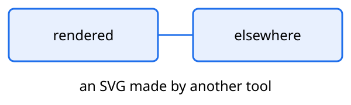

A sample of a figure is code, not a figure: this d2 fence was rendered.

````markdown
```d2 caption="An example"
a -> b
```
````

A picture link in code printed the machine's absolute path: write
`` beside the text, or as a block:

~~~

~~~

The real one, in prose, is still placed:


