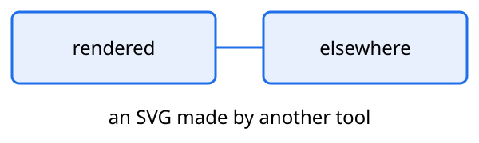

Typst 0.15 cannot embed a PDF under PDF/A or PDF/UA, and every figure was
placed as the PDF rsvg-convert drew: the figure is redrawn as an SVG with its
text in outlines. PDF/UA reads a picture and a formula out by their alt text.

```d2 caption="Where a job goes"
queue -> worker: pull
worker -> store: write
```

{width=30mm}

The loss is $J = \sum_t r_t$, summed over every step.
