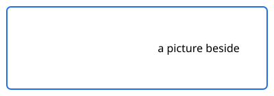

A linked SVG that places a picture beside it by a relative href. rsvg-convert
reads the copy in the work directory, where the href led nowhere, and left the
frame empty, exit 0.



A Vega image mark whose url is relative to the document vanished the same way.

```vega-lite caption="An image mark"
{"$schema": "https://vega.github.io/schema/vega-lite/v5.json",
 "width": 200, "height": 100,
 "data": {"values": [{"x": 1, "y": 1, "img": "diagrams/picture.png"}]},
 "mark": {"type": "image", "width": 40, "height": 40},
 "encoding": {"x": {"field": "x", "type": "quantitative"},
              "y": {"field": "y", "type": "quantitative"},
              "url": {"field": "img"}}}
```
